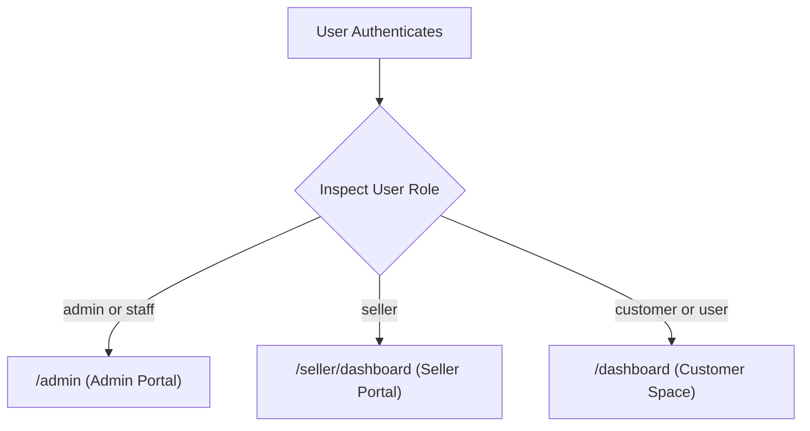
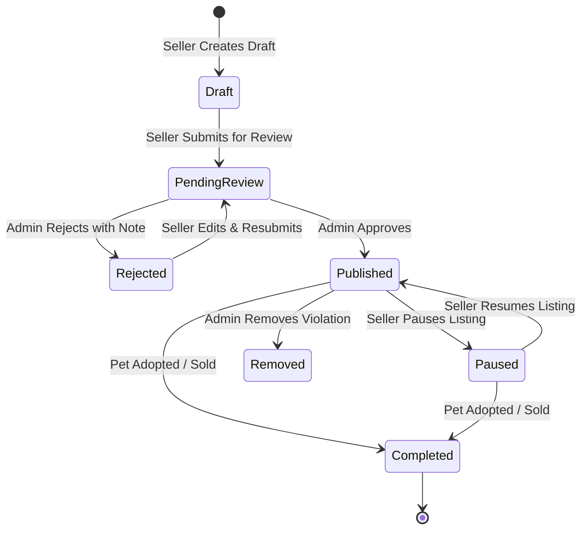
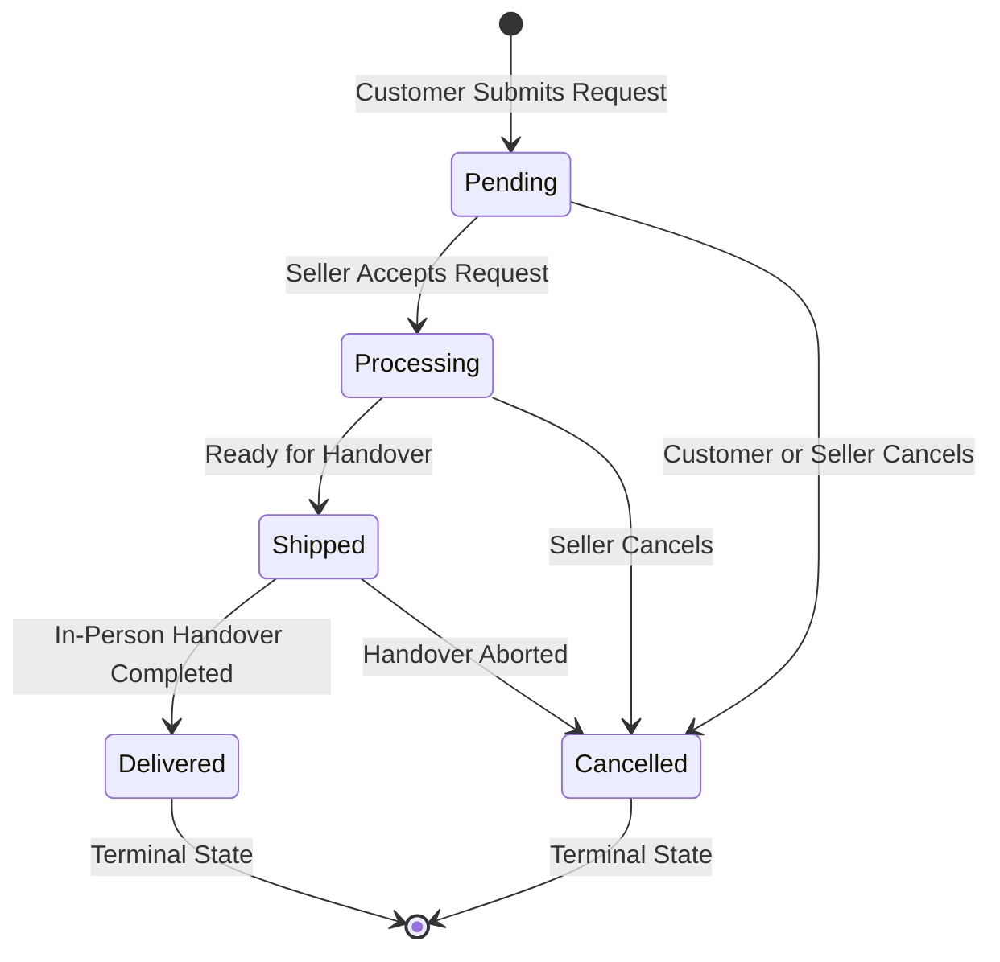

# PawHaven — Features & Role Architecture

PawHaven enforces strict, server-side role-based access control (RBAC). Every action is verified against authorization policies, ensuring complete tenant and data isolation.

---

## 1. User Roles & Permission Matrix

| Capability / Section | Guest / Public | Customer (`customer`) | Seller (`seller`) | Staff (`staff`) | Admin (`admin`) |
| :--- | :---: | :---: | :---: | :---: | :---: |
| **Browse Homepage & Catalog** | ✅ | ✅ | ✅ | ✅ | ✅ |
| **View Pet Listing Detail Pages** | ✅ | ✅ | ✅ | ✅ | ✅ |
| **Save / Bookmark Favorite Pets** | ❌ | ✅ | ❌ | ❌ | ❌ |
| **Submit Purchase / Adoption Requests** | ❌ | ✅ | ❌ | ❌ | ❌ |
| **Customer Dashboard & Timeline** | ❌ | ✅ | ❌ | ❌ | ❌ |
| **Cancel Pending Purchase Requests** | ❌ | ✅ | ❌ | ❌ | ✅ |
| **Create / Manage Own Seller Listings** | ❌ | ❌ | ✅ | ❌ | ❌ |
| **Upload Pet Photos (Max 5, 2MB)** | ❌ | ❌ | ✅ | ❌ | ❌ |
| **Seller Dashboard & Shop Metrics** | ❌ | ❌ | ✅ | ❌ | ❌ |
| **Process Incoming Customer Requests** | ❌ | ❌ | ✅ | ❌ | ✅ |
| **Record Verified Handover Payments** | ❌ | ❌ | ✅ | ❌ | ✅ |
| **Moderate Public Listings** | ❌ | ❌ | ❌ | ❌ | ✅ |
| **Website Customizer & CMS** | ❌ | ❌ | ❌ | ❌ | ✅ |
| **Single-Store Product Management** | ❌ | ❌ | ❌ | ✅ | ✅ |
| **Manage Users & Role Assignment** | ❌ | ❌ | ❌ | ❌ | ✅ |
| **System Health & Audit Logs** | ❌ | ❌ | ❌ | ❌ | ✅ |

---

## 2. Authentication & Redirection Behavior

When a user logs in, PawHaven automatically routes them to their authorized operational dashboard:

- **Seller Dedicated Login Shortcut**: `/seller/login` redirects directly with `?role=seller`.
- **Public Registration Limitation**: The public registration screen only permits creating `customer` or `seller` roles. Creating an `admin` or `staff` account via public registration is prohibited by Fortify validators; administrators must be created via the CLI command (`php artisan admin:create`) or assigned by an existing admin.

---

## 3. Pet Listing Lifecycle State Machine

Every pet listing transitions through strict status states governed by [PetListing.php](file:///D:/PawHaven/PH%20Web%20Version/WebApp/app/Models/PetListing.php) and [PetListingPolicy.php](file:///D:/PawHaven/PH%20Web%20Version/WebApp/app/Policies/PetListingPolicy.php):

- **`Draft`**: Private to the author seller. Not visible publicly or in the admin moderation queue.
- **`PendingReview`**: Visible only to the seller and administrators in the moderation queue (`/admin/marketplace/moderation`).
- **`Published`**: Active and visible to the public on the homepage, marketplace catalog, and category browse pages.
- **`Rejected`**: Returned to the seller with administrator feedback explaining the welfare or guideline concern.
- **`Paused`**: Temporarily hidden from public search by the seller (e.g. while coordinating with a prospective adopter).
- **`Completed`**: Successfully rehomed or adopted; removed from search results.
- **`Removed`**: Delisted permanently by an administrator for violation of animal welfare policies.

---

## 4. Purchase Request & Order State Machine

Transactional requests follow a formal progression enforced by [OrderStatus.php](file:///D:/PawHaven/PH%20Web%20Version/WebApp/app/Enums/OrderStatus.php):

- **Cash on Delivery (COD) / Direct Handover**: To prevent pet scams, payment is collected in cash upon physical inspection.
- **Automatic Payment Settlement**: When an order reaches `Delivered`, the COD payment status automatically updates from `Pending` to `Paid`.
