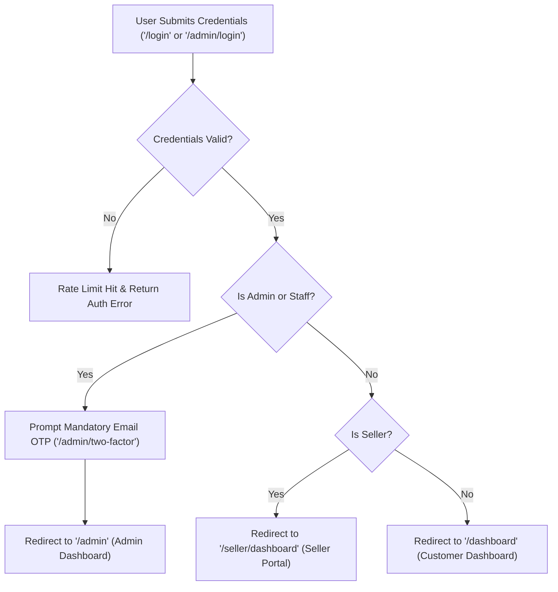
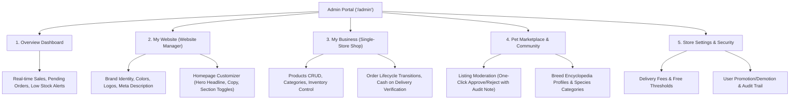
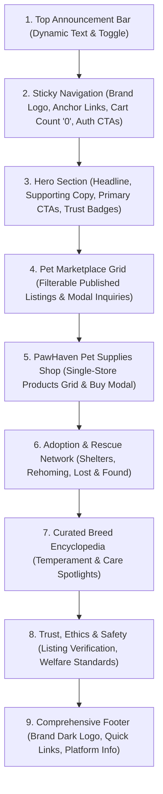
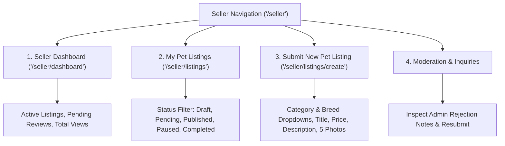

# PawHaven — Coherent Architecture & Feature Integration Plan

**Document Version:** 1.0  
**Effective Date:** October 30, 2026  
**Audited Location:** `<project-root>`
**Platform Classification:** Self-Hosted, Source-Code-Licensed Pet Commerce & Community Platform (Non-SaaS, Zero Veterinary/Medical Features)  

---

## 1. Architectural Principles & Integration Philosophy

This integration plan unifies existing backend assets with planned enhancements. It strictly complies with PawHaven core principles:
1. **Reuse First:** Preserve the 10 existing database migrations, 13 Eloquent models, 16 admin controllers, and 112 passing automated tests.
2. **Strict Domain Separation:**
   - **PawHaven Single-Shop:** Centrally administered by `admin` and `staff` for official pet food, toys, and supplies. No multi-vendor commissions, vendor payouts, or split checkouts.
   - **Community Pet Marketplace:** Individual pet listings submitted by `seller` (and rehoming owners), strictly pre-moderated by `admin` before public release.
   - **Adoption & Rescue Network:** Community hub for shelters, gentle rehoming, and lost-and-found reunification without commercial fees.
3. **Data Integrity & Immutability:** Never run destructive migrations (`migrate:fresh`, `db:wipe`). Model constraints, foreign key cascades, and status transition state machines must be preserved.
4. **Self-Hosting Independence:** Zero external developer-server calls, zero hidden licensing callbacks, and zero cloud SaaS dependencies. Code remains completely editable by the buyer.

---

## 2. Authentication & Role-Based Access Control Architecture

### Verified Role Definitions
- **`admin` (Super-Administrator):** Full governance over brand identity, homepage layout, moderation queue, user role assignments, audit logs, and business settings.
- **`staff` (Shop & Operations Staff):** Operational access to products, inventory adjustments, order processing, and customer directories.
- **`seller` (Marketplace Pet Lister / Owner):** Submits and manages their own commercial and rehoming pet listings. Views moderation feedback, pauses/marks completed listings, and responds to customer adoption/purchase inquiries.
- **`customer` (Public User / Buyer):** Submits purchase requests for single-store supplies, tracks order status, saves favorite pets, and manages profile security.
- **`guest` (Unauthenticated Visitor):** Can browse the public homepage, search published listings, read breed profiles, and explore community resources.



### Required Minimal Architectural Changes
1. **Resolve Post-Login Redirection (`app/Http/Responses/LoginResponse.php`):**
   - Ensure `route('seller.dashboard')` points to a registered controller action.
   - Clear any stale intended URLs pointing to unauthorized areas (`/admin` for non-staff; `/seller` for non-sellers).
2. **Resolve Route Redirection (`routes/web.php`):**
   - In `/dashboard`:
     ```php
     if ($user->isAdmin() || $user->isStaff()) {
         return redirect()->route('admin.dashboard');
     }
     if ($user->isSeller()) {
         return redirect()->route('seller.dashboard');
     }
     return view('dashboard', compact('orders'));
     ```
3. **Enforce Role Middleware:**
   - Introduce `EnsureUserIsSeller` (`'seller'` middleware alias) guarding all `/seller/*` routes.
   - Verify `EnsureUserIsStaffOrAdmin` restricts `/admin` operational routes strictly to `admin` and `staff`.

---

## 3. Admin Dashboard & Website Manager Integration

The administrative portal (`/admin`) is organized into five cohesive management zones:



### Detailed Zone Architecture

#### Zone 1: Overview Dashboard (`Admin\DashboardController@index`)
- Displays real-time database KPIs:
  - Today's Sales Minor (`orders()->whereDate('created_at', today())->sum('total_minor')`)
  - Pending Orders Count (`orders()->where('status', OrderStatus::Pending)->count()`)
  - Low Stock Products (`products()->whereColumn('stock_quantity', '<=', 'low_stock_threshold')->count()`)
  - Pending Listing Moderation (`petListings()->where('status', PetListingStatus::PendingReview)->count()`)
- Recent 5 orders table with status badges and quick action links.
- Recent 6 administrative audit log entries.

#### Zone 2: Website Manager (`BrandIdentityController` & `HomepageCustomizerController`)
- **Brand Identity:** Edit platform name, tagline, primary `#245C45`, secondary `#173F32`, accent `#F28C75`, support contact email, phone, physical address, and meta description.
- **Media Uploads:** Upload light logo, dark logo, and favicon with strict validation (image, mimes:png,jpg,jpeg,webp, max 2MB, dimensions max 3000x3000px).
- **Homepage Live Customizer:**
  - Hero headline (default: *“Your next best friend is waiting.”*).
  - Supporting copy (default: *“Discover pets, shop food and accessories, and help animals find loving homes—all in one place.”*).
  - Primary, Secondary, and Adoption CTA button labels and URLs.
  - Top announcement banner text and visibility toggle.
  - Section visibility toggles for `#find-pets`, `#pet-shop`, `#adoption-rescue`, `#breeds`, `#community`, and Trust & Safety.

#### Zone 3: My Business — Single-Store Commerce
- **Catalog Management:** Products with auto-slug generation, uppercase unique SKU, integer minor unit pricing, optional sale prices, ingredients, and storage instructions. Deleting products linked to historical orders is strictly blocked (`restrictOnDelete` / `OrderItem::where('product_id', $product->id)->exists()`).
- **Inventory Adjustments:** Real-time stock monitor with inline increment/decrement adjustments logging directly to `AdminAuditLog`.
- **Order Lifecycle Management:** State machine transitions (`Pending` &rarr; `Confirmed` &rarr; `Processing` &rarr; `Shipped` &rarr; `Delivered` or `Cancelled`). Enforces mandatory cancellation reason and payment status tracking (`Pending`, `Paid`, `Refunded`).

#### Zone 4: Pet Marketplace & Community Governance
- **Moderation Queue:** Pre-moderation queue displaying pet photos, category, breed, seller details, and listing description.
- One-click **Approve** transitions listing status to `Published`.
- One-click **Reject** requires a mandatory explanatory reason, saved permanently into `listing_moderation_actions` with foreign key integrity.

#### Zone 5: Store Settings & System Security
- Delivery fee configuration (`shop.delivery_fee_minor`) and free delivery threshold (`shop.free_delivery_threshold_minor`).
- Cash on Delivery (COD) payment method toggle.
- Staff and user role promotions with anti-self-demotion safeguards.
- Full administrative audit trail with expandable JSON payload modal.

---

## 4. Public Homepage & Public Website Experience

### Layout & Structural Sections (`resources/views/welcome.blade.php`)



### Content Separation Rules
- **Commercial Listings vs. Adoption Posts:** 
  - Listings with `listing_type === PetListingType::Sale` display price tags (e.g. `$450.00`) and "Buy / Reserve" actions.
  - Listings with `listing_type in [PetListingType::Adoption, PetListingType::Rescue, PetListingType::Rehoming]` display "Adoption / Gentle Rehoming" badges, have no sale price, and feature "Apply to Adopt" actions.
- **Published Scope Enforcement:** Public queries must strictly filter `where('status', PetListingStatus::Published)` to ensure draft or rejected listings are never leaked to guests.
- **Real Database Content:** If no listings or products exist, render ethical styled empty-state cards; never inject fake database records into public production views.

---

## 5. Seller Dashboard & Portal Architecture

The Seller Portal provides pet owners, breeders, and verified shelters with an isolated, secure interface:



### Detailed Functional Requirements
1. **Ownership Isolation (`PetListingPolicy`):**
   - Sellers can only view, edit, or delete listings where `seller_id === auth()->id()`.
   - Sellers cannot moderate listings or alter their own status to `Published` (only `Draft` or `PendingReview`).
2. **Listing Submission Wizard:**
   - Step 1: Select Pet Category (Dog, Cat, Bird, etc.) & Breed.
   - Step 2: Listing Type (`sale`, `adoption`, `rehoming`, `lost_found`).
   - Step 3: Title, description preview, and location.
   - Step 4: Price minor (required if `sale`; disabled/null for adoption/rescue).
   - Step 5: Multi-image upload (up to 5 photos, max 2MB each, stored in `storage/app/public/listings/`).
3. **Availability & Status Management:**
   - Sellers can toggle status between `Published` and `Paused` (e.g., if pet is temporarily on hold).
   - Once a pet is adopted or sold, the seller marks it `Completed`.

---

## 6. Customer Dashboard & Commerce Integration

The Customer Dashboard (`/dashboard`) serves as the buyer and community hub:

### 1. Account Metrics Overview
- **My Pet Listings:** Total pets submitted by customer (e.g., for gentle rehoming or lost-and-found).
- **Shop Orders:** Total direct orders placed with the PawHaven Pet Shop.
- **Account Verification:** Email verification status and passkey / 2FA status.

### 2. Purchase Requests & Orders Management
- Paginated table consuming `auth()->user()->orders()->with('items.product')->latest()`.
- Table columns: Order Number, Products & Quantities, Order Status badge, Payment Method (Cash on Delivery), Delivery Fee, and Order Total.
- Details modal or view showing delivery address, notes, and cancellation reason if cancelled.

### 3. Shopping Cart & Checkout (Milestone 6 Integration)
- **Session Cart:** Supports adding single-store products, adjusting quantities (1..10), and removing items without page reloads.
- **Dedicated Checkout (`/checkout`):**
  - Shipping address, contact phone, delivery notes.
  - Real-time subtotal calculation.
  - Delivery fee calculated dynamically: if `subtotal_minor >= Settings::get('shop.free_delivery_threshold_minor')`, delivery fee is `$0.00`; otherwise `Settings::get('shop.delivery_fee_minor')`.
  - Payment Method: Cash on Delivery (COD) confirmation.
  - On submission: Generates unique `order_number` (`PH-XXXXXXXX`), decreases product inventory stock, records `order_items`, and redirects to receipt page.

---

## 7. Shared Business Workflows & State Machines

### 1. Order State Machine (`App\Enums\OrderStatus`)
```
[Pending] -------> [Confirmed] -------> [Processing] -------> [Shipped] -------> [Delivered]
    |                  |                     |
    +------------------+---------------------+---------------------------------> [Cancelled]
```
- Transition rules enforced in `Order::canTransitionTo($newStatus)`.
- Transitioning to `Cancelled` requires a non-empty `cancelled_reason`.
- Payment status (`Pending` &rarr; `Paid`) can be marked upon delivery for COD orders.

### 2. Pet Listing Moderation State Machine (`App\Enums\PetListingStatus`)
```
[Draft] -------> [Pending Review] -------> [Published] <-------> [Paused]
                        |                      |
                        v                      v
                   [Rejected]             [Completed]
                        |
                        v
                    [Removed]
```
- A newly submitted pet listing enters `Pending Review`.
- Only an administrator can transition a listing to `Published` or `Rejected`.
- Rejections record the administrator ID, timestamp, and audit note into `listing_moderation_actions`.
- Sellers can edit a `Rejected` listing to address concerns and resubmit it to `Pending Review`.

---

## 8. Configuration, Security & Deployment Checklist

### Production Configuration Standards
- `.env` must have `APP_DEBUG=false`, secure `APP_KEY`, and production `APP_URL`.
- Session driver configured for secure cookies (`SESSION_SECURE_COOKIE=true` on HTTPS, `SESSION_HTTP_ONLY=true`, `SameSite=Lax`).
- Database: SQLite or MySQL without external network dependencies.
- Storage: `public/storage` connected via `php artisan storage:link`.

### Security Safeguards
- **CSRF Defense:** Verified on all POST, PUT, PATCH, DELETE routes.
- **Mass-Assignment Defense:** Models strictly limit `$fillable` attributes.
- **XSS Defense:** Blade `{{ ... }}` auto-escaping utilized everywhere; user inputs sanitized.
- **Upload Validation:** Extension validation, MIME sniffing, max file size limits (2MB).
- **Rate Limiting:** Throttle 5 attempts per minute on login, password resets, and OTP generation.
- **Zero SaaS Dependencies:** Platform runs entirely self-contained on the buyer's server.

