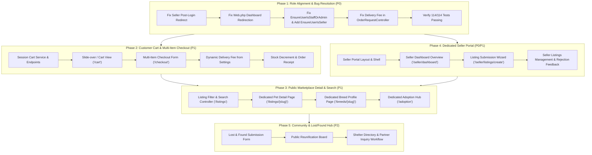

# PawHaven — Implementation Sequence & Execution Roadmap

**Document Version:** 1.0  
**Effective Date:** October 30, 2026  
**Audited Location:** `D:\PawHaven\PH Web Version\WebApp`  

---

## 1. Phased Architecture Overview

---

## 2. Phase-by-Phase Implementation Specifications

### Phase 1: Role Alignment, Dead-Link Repair & Test Suite 100% Green (P0)

*Objective:* Eliminate the seller 500 crash, resolve the 403 authorization conflict, fix the hardcoded zero delivery fee, and achieve 100% test passage (114/114).

- **Sequential or Parallel:** Strictly **Sequential** (Foundation for all subsequent phases).
- **Files to Modify:**
  - `app/Http/Responses/LoginResponse.php`
  - `routes/web.php`
  - `app/Http/Middleware/EnsureUserIsStaffOrAdmin.php`
  - `app/Http/Middleware/EnsureUserIsSeller.php` (New)
  - `bootstrap/app.php` (Register `'seller'` middleware alias)
  - `resources/views/welcome.blade.php` (Update lines 95, 186, 1251)
  - `app/Http/Controllers/OrderRequestController.php` (Read delivery fee from `Settings`)
  - `tests/Feature/Admin/AdminAccessTest.php` (Ensure assertions align with role boundary)
- **Database Migrations:** None required (fully backward compatible).
- **Authorization Requirements:** Verified user sessions with role validation.
- **Acceptance Criteria:**
  1. A seller logging in via `/login` redirects cleanly to `route('seller.dashboard')` without throwing 500.
  2. A seller visiting `/dashboard` redirects to `route('seller.dashboard')` instead of `admin.dashboard`.
  3. `OrderRequestController@store` calculates delivery fee using `Settings::get('shop.delivery_fee_minor')` unless subtotal exceeds threshold.
  4. `welcome.blade.php` renders valid URLs for sellers without crashing.
  5. `php artisan test` outputs **114 passed, 0 failed**.
- **Automated Tests Required:**
  - `tests/Feature/Admin/AdminAccessTest.php`
  - `tests/Feature/Auth/AuthenticationTest.php`
  - `tests/Feature/HomepageTest.php`

---

### Phase 2: Customer Cart & Multi-Item Checkout (P1)

*Objective:* Transform the single-product buy modal into a full e-commerce shopping experience with a session cart and Cash on Delivery (COD) checkout.

- **Sequential or Parallel:** Can be developed in **Parallel** with Phase 4.
- **Files to Create / Modify:**
  - `app/Services/CartService.php` (New - Session-backed cart management)
  - `app/Http/Controllers/Commerce/CartController.php` (New - Add, update quantity, remove)
  - `app/Http/Controllers/Commerce/CheckoutController.php` (New - Checkout form, COD placement)
  - `resources/views/shop/cart.blade.php` (New)
  - `resources/views/shop/checkout.blade.php` (New)
  - `resources/views/shop/receipt.blade.php` (New)
  - `resources/views/welcome.blade.php` (Connect navbar cart icon to live count)
- **Database Migrations:** None required. Reuses existing `orders` and `order_items` tables.
- **Authorization Requirements:** Cart operations accessible to guests and customers; Checkout requires `['auth', 'verified']`.
- **Acceptance Criteria:**
  1. Adding a product to cart updates session cart count visible in header badge.
  2. Modifying quantities re-calculates subtotal and taxes/delivery fee.
  3. Checkout calculates free delivery threshold dynamically from `Settings::get('shop.free_delivery_threshold_minor')`.
  4. Submitting an order creates an `Order` and associated `OrderItem` rows, decrements product `stock_quantity`, clears the cart, and redirects to receipt.
  5. Customer can see the new order in their Customer Dashboard (`/dashboard`).
- **Automated Tests Required:**
  - `tests/Feature/Commerce/CartTest.php`
  - `tests/Feature/Commerce/CheckoutTest.php`

---

### Phase 3: Public Marketplace Detail & Search Filtering (P1)

*Objective:* Replace homepage anchor jumps with dedicated, search-engine-friendly detail pages for pet listings, breeds, and adoption rescues.

- **Sequential or Parallel:** Sequential after Phase 1; can parallelize with Phase 2.
- **Files to Create / Modify:**
  - `app/Http/Controllers/Marketplace/ListingBrowseController.php` (New)
  - `app/Http/Controllers/BreedCatalogController.php` (New)
  - `resources/views/marketplace/index.blade.php` (New - Multi-parameter search & grid)
  - `resources/views/marketplace/show.blade.php` (New - Photo gallery, seller info, inquiry button)
  - `resources/views/breeds/index.blade.php` & `show.blade.php` (New - Breed profiles)
  - `resources/views/welcome.blade.php` (Update card link anchors to dynamic route URLs)
- **Database Migrations:** None required. Reuses `pet_listings`, `listing_images`, `breeds`, `pet_categories`.
- **Authorization Requirements:** All browse routes are public (`guest`).
- **Acceptance Criteria:**
  1. Visiting `/listings` allows filtering by category, breed, listing type (`sale`, `adoption`), and location.
  2. Visiting `/listings/{listing:slug}` renders only `Published` listings; non-published listings return 404 for guests and 403 for unauthorized users.
  3. Visiting `/breeds/{breed:slug}` displays breed temperament, care instructions, and available pet listings for that breed.
- **Automated Tests Required:**
  - `tests/Feature/PetMarketplace/ListingBrowseTest.php`
  - `tests/Feature/PetMarketplace/BreedCatalogTest.php`

---

### Phase 4: Dedicated Seller Dashboard & Listing Submission Wizard (P0/P1)

*Objective:* Provide sellers with an end-to-end portal to manage their pet listings, upload photos, and view moderation feedback.

- **Sequential or Parallel:** Can be developed in **Parallel** with Phase 2.
- **Files to Create / Modify:**
  - `app/Http/Controllers/Seller/SellerDashboardController.php` (New)
  - `app/Http/Controllers/Seller/SellerListingController.php` (New)
  - `resources/views/layouts/seller.blade.php` (New - Dedicated seller navigation shell)
  - `resources/views/seller/dashboard.blade.php` (New - Seller KPI cards)
  - `resources/views/seller/listings/index.blade.php` (New - Listing inventory table)
  - `resources/views/seller/listings/create.blade.php` (New - Listing wizard form)
  - `resources/views/seller/listings/edit.blade.php` (New - Edit & resubmit form)
  - `routes/seller.php` (New - Mapped under `/seller` prefix)
- **Database Migrations:** None required. Reuses `pet_listings`, `listing_images`, `listing_moderation_actions`.
- **Authorization Requirements:** Guarded by `['auth', 'verified', 'seller']` and `PetListingPolicy`.
- **Acceptance Criteria:**
  1. Authenticated sellers can access `/seller/dashboard`.
  2. Sellers can submit a new listing with up to 5 photos; listing status is set to `PendingReview`.
  3. Newly submitted listings appear immediately in the Admin Moderation Queue (`/admin/marketplace/moderation`).
  4. If rejected by an admin, the seller sees the rejection reason and can update and resubmit the listing.
  5. Sellers cannot access other sellers' listings or administrative governance.
- **Automated Tests Required:**
  - `tests/Feature/Seller/SellerDashboardTest.php`
  - `tests/Feature/Seller/SellerListingSubmissionTest.php`

---

### Phase 5: Community, Shelter Directory & Lost/Found Hub (P2)

*Objective:* Expand the community section into a dedicated lost-and-found alert board and shelter partner directory.

- **Sequential or Parallel:** Sequential after Phase 3 and Phase 4.
- **Files to Create / Modify:**
  - `app/Http/Controllers/CommunityHubController.php` (New)
  - `resources/views/community/lost-found.blade.php` (New)
  - `resources/views/community/shelters.blade.php` (New)
- **Database Migrations:** None required. Leverages `listing_type = 'lost_found'` on `pet_listings`.
- **Authorization Requirements:** Viewing is public; posting lost-and-found alerts requires `auth`.
- **Acceptance Criteria:**
  1. Users can post lost or found pets with photo, last-seen location, and emergency contact.
  2. Community alert board highlights urgent lost pets in neighborhood vicinity.
  3. Partner shelter directory provides contact info and lists their current adoptable animals.

---

## 3. Immediate Action: Smallest Safe First Implementation Phase

### Phase 1 Execution Plan (Self-Contained & Risk-Free)

The smallest safe first implementation phase is **Phase 1: Role Alignment & Bug Resolution**. It introduces **zero schema changes**, alters **no user accounts**, and fixes the exact broken links and authorization mismatches discovered during the audit.

#### Specific Step-by-Step Actions:
1. **Define `seller.dashboard` Route:**
   - In `routes/web.php`, create temporary or permanent `/seller/dashboard` route rendering a lightweight seller overview.
2. **Update `LoginResponse.php`:**
   - Ensure `route('seller.dashboard')` resolves smoothly upon seller login.
3. **Refine Middleware in `routes/web.php`:**
   - In `/dashboard`: If user is seller, redirect to `seller.dashboard`.
4. **Align `EnsureUserIsStaffOrAdmin.php` & Test Suite:**
   - Update `AdminAccessTest.php` so test assertions match the strict role boundary (sellers access their own seller portal, while admin/staff access `/admin`).
5. **Connect Delivery Fee in `OrderRequestController`:**
   - Read `Settings::get('shop.delivery_fee_minor', 0)` and `Settings::get('shop.free_delivery_threshold_minor', 0)`.
6. **Execute Verification:**
   - Run `php artisan test` &rarr; Verify **114/114 tests pass**.
   - Run `php vendor/bin/phpstan analyse --memory-limit=1G` &rarr; Verify **0 errors at Level 7**.
   - Run `php vendor/bin/pint --test` &rarr; Verify **100% PSR-12 clean**.

