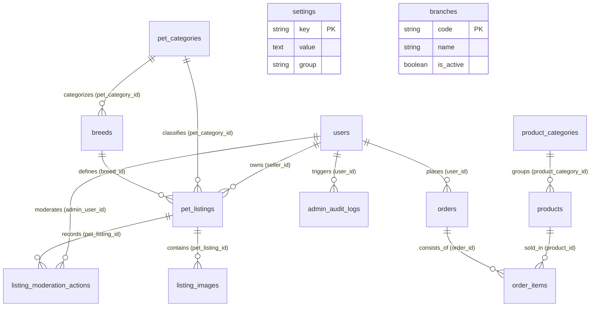
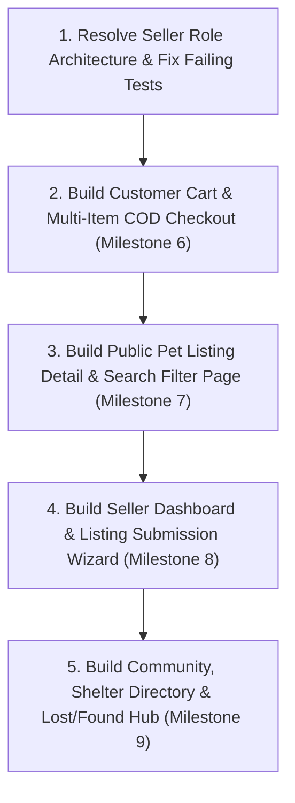

# PawHaven — Existing Project Comprehensive Audit Report

**Report Date:** October 30, 2026  
**Audited Location:** `D:\PawHaven\PH Web Version\WebApp`  
**Platform Nature:** Self-hosted, source-code-licensed pet commerce and adoption/rescue platform (Non-SaaS, No Veterinary/Medical Features)  
**Audit Mode:** Non-Destructive, Evidence-Based, Read-Only First  

---

## 1. Executive Summary

PawHaven has already undergone extensive architectural, backend, administrative, and design system development. It is **not** an empty or default Laravel starter kit. 

The application currently possesses:
- A fully articulated database schema (10 migrations, 13 Eloquent models, 4 typed Enums, model factories).
- A rich public homepage with dynamic setting bindings, pet marketplace grid, e-commerce products grid, breed spotlights, adoption network entry points, accessible navigation, and modal purchase workflows.
- A complete **Admin Dashboard & Single-Store Commerce Backend** across 16 dedicated controllers, master layouts, responsive navigation, and 18 administrative views (product catalog, inventory monitor, order lifecycle management, customer directory, listing moderation queue, breed profiles, brand customizer, homepage layout manager, staff roles, and audit trail).
- High code quality with **PHPStan Level 7 (0 errors)**, Laravel Pint (100% PSR-12 compliant), Vite Plus frontend production asset builds, and an automated test suite of **114 tests (112 passing, 2 failing due to a single architectural contradiction around the Seller role)**.
- Full self-hosting independence: zero external telemetry, zero SaaS cloud dependencies, and zero remote licensing callbacks.

However, the audit identified **one critical architectural flaw and several functional gaps**:
1. **Critical Defect (Seller Role Dead-Lock):** While the Customer Dashboard (`/dashboard`) and Admin Dashboard (`/admin`) exist, **no Seller Dashboard (`seller.dashboard`) exists**. Furthermore:
   - `LoginResponse.php` redirects sellers to `route('seller.dashboard')`, which crashes with a 500 `RouteNotFoundException`.
   - `routes/web.php` redirects authenticated sellers from `/dashboard` to `admin.dashboard`.
   - `admin.dashboard` is protected by `EnsureUserIsStaffOrAdmin`, which immediately blocks sellers with a `403 Forbidden`.
   - `welcome.blade.php` links to `route('seller.dashboard')` in the header, mobile drawer, and footer, causing 500 crashes if a logged-in seller views the homepage.
2. **Missing Customer Detail Pages:** Dedicated single pet listing pages (`/listings/{slug}`), dedicated breed encyclopedia detail pages, and a dedicated multi-product shopping cart/checkout flow are not yet built (the homepage currently uses anchor jumps and a direct buy-request modal).
3. **Hardcoded Fee in Buy Request:** `OrderRequestController@store` sets `delivery_fee_minor = 0` instead of reading `Settings::get('shop.delivery_fee_minor')`.

---

## 2. Verified Environment and Stack

| Component | Verified Version / Setting | Source / Evidence |
| :--- | :--- | :--- |
| **PHP Runtime** | PHP 8.5.0 (cli) NTS Visual C++ 2022 x64 | Herd Lite (`php -v`) |
| **Composer** | 2.10.0 | `composer -V` |
| **Node.js** | v24.22.1 | `node -v` |
| **npm** | 11.19.1 | `npm -v` |
| **Laravel Framework** | 13.17 / 13.35 | `composer.json` (`laravel/framework: ^13.17`) |
| **Livewire** | 4.1 | `composer.json` (`livewire/livewire: ^4.1`) |
| **Flux UI** | 2.13.1 | `composer.json` (`livewire/flux: ^2.13.1`) |
| **Livewire Blaze** | 1.0 | `composer.json` (`livewire/blaze: ^1.0`) |
| **Laravel Fortify** | 1.37.2 | `composer.json` (`laravel/fortify: ^1.37.2`) |
| **Tailwind CSS** | 4.0.7 / @tailwindcss/vite 4.1.11 | `package.json`, `resources/css/app.css` |
| **Vite / Bundler** | Vite 8.0.0, Vite Plus 0.3.0 | `package.json`, `vite.config.js` |
| **Database** | SQLite (`database/database.sqlite`), size ~290 KB | `database/migrations`, 10 migrations ran |
| **Static Analysis** | Larastan / PHPStan Level 7 | `phpstan.neon`, 0 errors |
| **Code Style** | Laravel Pint | `pint.json`, 100% passing |
| **Git Baseline** | Branch `master`, commit `c9c3eab` | 27 modified files, 46 untracked files preserved |

---

## 3. Public Page and Route Inventory

| Route Path | Route Name | Controller / Handler | Data Models | Verified Status |
| :--- | :--- | :--- | :--- | :--- |
| `/` | `home` | Closure in `routes/web.php` | `PetListing`, `Product`, `Setting` | **Complete / Working** (Consumes dynamic DB items & settings) |
| `/listings/{slug}` | — | *None* | `PetListing`, `ListingImage` | **Missing** (Card CTAs jump to `#find-pets` anchor) |
| `/breeds/{slug}` | — | *None* | `Breed`, `PetCategory` | **Missing** (Featured breeds link to `#breeds` anchor) |
| `/adoption-rescue` | — | *None* | `PetListing` | **Partial** (Represented as homepage section `#adoption-rescue`) |
| `/login` | `login` | Fortify `AuthenticatedSessionController@create` | `User` | **Complete / Working** (Custom PawHaven split layout) |
| `/register` | `register` | Fortify `RegisteredUserController@create` | `User` | **Complete / Working** (Allows customer or seller) |
| `/forgot-password` | `password.request` | Fortify `PasswordResetLinkController@create` | `User` | **Complete / Working** |
| `/reset-password/{token}` | `password.reset` | Fortify `NewPasswordController@create` | `User` | **Complete / Working** |
| `/two-factor-challenge` | `two-factor.login` | Fortify `TwoFactorAuthenticatedSessionController` | `User` | **Complete / Working** |
| `/admin/login` | `admin.login` | `Admin\AdminAuthController@showLoginForm` | `User` | **Complete / Working** (Internal admin gateway) |
| `/admin/two-factor` | `admin.two-factor` | `Admin\AdminAuthController@showTwoFactorForm` | `User` | **Complete / Working** (Email OTP 2FA) |
| `/seller/login` | `seller.login` | Redirects to `/login?role=seller` | `User` | **Complete / Working** |
| `/seller/register` | `seller.register` | Redirects to `/register?role=seller` | `User` | **Complete / Working** |
| `/dashboard` | `dashboard` | Closure in `routes/web.php` | `User`, `Order`, `OrderItem` | **Complete for Customers; Broken for Sellers** |
| `/orders/request` | `orders.request` | `OrderRequestController@store` | `Order`, `OrderItem`, `Product` | **Complete / Working** (Direct purchase request) |
| `/settings/profile` | `profile.edit` | Livewire `pages::settings.profile` | `User` | **Complete / Working** |
| `/settings/appearance` | `appearance.edit` | Livewire `pages::settings.appearance` | `User` | **Complete / Working** |
| `/settings/security` | `security.edit` | Livewire `pages::settings.security` | `User`, Passkeys | **Complete / Working** |

---

## 4. Admin / Seller / Customer Feature Matrix

| Feature Domain | Admin | Staff | Seller | Customer |
| :--- | :---: | :---: | :---: | :---: |
| **Console Access** | Full (`/admin`) | Operational (`/admin`) | **Locked Out (403/500)** | Denied (403) |
| **KPI & Sales Analytics** | Yes | Yes | None | None |
| **Product Catalog CRUD** | Yes | Yes | No | View only |
| **Inventory Adjustments** | Yes | Yes | No | View stock only |
| **Order Processing & Invoicing** | Full | Full | None | View own buy requests |
| **Pet Marketplace Moderation** | Approve / Reject | View only | None | None |
| **Pet Listing Creation** | View all | View all | Policy ready / **UI Missing** | None |
| **Brand & Colors Customizer** | Full | Denied | Denied | Denied |
| **Homepage Layout Customizer** | Full | Denied | Denied | Denied |
| **User Roles & Permissions** | Full (Anti-self-demotion) | Denied | Denied | Denied |
| **Audit Logs Inspection** | Full | Denied | Denied | Denied |
| **Business Settings & Branches** | Full | Denied | Denied | Denied |
| **Single-Product Buy Request** | N/A | N/A | N/A | Yes (Modal & Dashboard) |
| **Cart & Multi-Item Checkout** | N/A | N/A | N/A | **Pending Milestone 6** |

---

## 5. Database Model and Relationship Map



### Verified Schema Specifications

1. **`users` Table:**
   - Columns: `id`, `name`, `email`, `email_verified_at`, `password`, `two_factor_secret`, `two_factor_recovery_codes`, `two_factor_confirmed_at`, `role` (`customer`, `seller`, `staff`, `admin`), `remember_token`, `timestamps`.
   - Security: `role` is guarded against mass-assignment (`#[Fillable(['name', 'email', 'password'])]`).
2. **`pet_categories` Table:**
   - Columns: `id`, `name` (unique), `slug` (unique), `timestamps`.
3. **`breeds` Table:**
   - Columns: `id`, `pet_category_id` (FK to `pet_categories`, restrict on delete), `name`, `slug`, `description`, `care_information`, `timestamps`. Unique constraint on `[pet_category_id, name]` and `[pet_category_id, slug]`.
4. **`pet_listings` Table:**
   - Columns: `id`, `seller_id` (FK to `users`, restrict on delete), `pet_category_id` (FK to `pet_categories`, restrict on delete), `breed_id` (FK to `breeds`, null on delete), `title`, `description`, `listing_type` (`PetListingType`), `price_minor` (nullable unsigned big integer), `location`, `status` (`PetListingStatus`), `timestamps`.
5. **`listing_images` Table:**
   - Columns: `id`, `pet_listing_id` (FK to `pet_listings`, cascade on delete), `path`, `position` (unsigned small integer, default 0), `timestamps`. Unique constraint on `[pet_listing_id, position]`.
6. **`listing_moderation_actions` Table:**
   - Columns: `id`, `pet_listing_id` (FK to `pet_listings`, null on delete), `admin_user_id` (FK to `users`, null on delete), `action`, `note`, `timestamps`.
7. **`settings` Table:**
   - Columns: `id`, `key` (unique index), `value` (nullable text), `group` (indexed string), `timestamps`.
8. **`product_categories` Table:**
   - Columns: `id`, `name`, `slug` (unique), `description`, `order`, `is_active`, `timestamps`.
9. **`products` Table:**
   - Columns: `id`, `product_category_id` (FK to `product_categories`, cascade on delete), `name`, `slug` (unique), `sku` (unique), `description`, `price_minor`, `sale_price_minor`, `stock_quantity`, `low_stock_threshold`, `is_published`, `is_featured`, `image_path`, `ingredients`, `storage_instructions`, `timestamps`.
10. **`orders` Table:**
    - Columns: `id`, `order_number` (unique index), `user_id` (FK to `users`, null on delete), `customer_name`, `customer_email`, `customer_phone`, `shipping_address`, `shipping_city`, `shipping_state`, `shipping_postal_code`, `status` (`OrderStatus`), `payment_method` (default `'cod'`), `payment_status` (`PaymentStatus`), `subtotal_minor`, `delivery_fee_minor`, `total_minor`, `notes`, `cancelled_reason`, `timestamps`.
11. **`order_items` Table:**
    - Columns: `id`, `order_id` (FK to `orders`, cascade on delete), `product_id` (FK to `products`, null on delete), `product_name`, `sku`, `price_minor`, `quantity`, `subtotal_minor`, `timestamps`.
12. **`branches` Table:**
    - Columns: `id`, `name`, `code` (unique), `phone`, `email`, `address`, `is_active`, `timestamps`.
13. **`admin_audit_logs` Table:**
    - Columns: `id`, `user_id` (FK to `users`, null on delete), `action`, `description`, `ip_address`, `payload` (JSON nullable), `timestamps`.

---

## 6. Existing UI Component Inventory

### Design System Tokens
- **Forest Green (`#245C45`):** Primary branding, buttons, active navigation, badges.
- **Deep Green (`#173F32`):** Primary dark accent, announcements, admin header, footer background.
- **Warm Ivory (`#FAF8F2`):** Body background, light card background.
- **Soft Coral (`#F28C75`):** Pulse notifications, accent tags, contrast highlights.
- **Charcoal Dark (`#202820`):** Primary headings, high-contrast typography, borders (`#202820]/10`).
- **Muted Slate (`#69736B`):** Supporting copy, secondary icons, metadata tags.

### Logo Assets & Destination Verification
- **Source Directory:** `D:\PawHaven\PawHaven Logos\`
  - `PawHeaven-Green-logo.png` (156,938 bytes)
  - `PawHeaven-NavyBlue-logo.png` (256,962 bytes)
  - `PawHeaven-White-logo.png` (124,497 bytes)
- **Application Web Assets (`public/images/`):**
  - `pawhaven-logo-green.png` &rarr; used as default light logo (`brand.logo_light_path`)
  - `pawhaven-logo-white.png` &rarr; used as default dark logo (`brand.logo_dark_path`)
  - `pawhaven-logo-navy.png` &rarr; dark navy variant
- **Blade Integration:**
  - `welcome.blade.php`: Header uses `brand.logo_light_path`; footer uses `brand.logo_dark_path`.
  - `resources/views/layouts/admin.blade.php`: Sidebar uses `brand.logo_dark_path`.
  - `resources/views/admin/auth/login.blade.php`: Header card uses `brand.logo_dark_path`.
  - `resources/views/components/app-logo-icon.blade.php`: Uses `brand.logo_light_path`.

### Reusable UI Components
- **Layouts:**
  - `layouts.app` (Livewire / Customer application layout with sidebar & header)
  - `layouts.admin` (Administrative dashboard layout with dark theme sidebar, profile bar, alert toasts)
  - `layouts.auth.split` (Branded split-screen layout for authentication)
  - `layouts.auth.card` & `layouts.auth.simple` (Alternative Fortify card layouts)
- **Admin Views:** 18 dedicated Blade templates in `resources/views/admin/` with uniform responsive tables, filter inputs, status pills, and confirmation modals.
- **Homepage:** High-density, fully responsive Blade template with Alpine.js state for mobile drawers, product buy modal, dynamic listing cards, and fallback illustrations.

---

## 7. Authentication and Authorization Findings

1. **Self-Registration Role Downgrade:**
   - In `app/Actions/Fortify/CreateNewUser.php`, registration allows selecting `role` (`customer` or `seller`). If an attacker passes `role => 'admin'`, the code explicitly downgrades it to `customer`.
2. **Admin-Only Isolation:**
   - Route group `prefix('admin')` has two tiers:
     - `staff_or_admin`: Access to products, inventory, orders, customers, listings, breeds, and community settings.
     - `admin`: Strict administrator governance for brand identity, homepage customizer, moderation queue, user role management, business settings, and audit logs.
3. **Mandatory Administrative 2FA:**
   - Admin login (`/admin/login`) requires password authentication followed by a mandatory 6-digit email OTP (`/admin/two-factor`).
4. **Account Deletion Safeguards:**
   - In `resources/views/pages/settings/⚡delete-user-modal.blade.php`, account deletion is blocked if the user has active pet listings (`User::petListings()->where('status', '!=', 'removed')->exists()`).
5. **CRITICAL AUTH BUG: Seller Role Lockout:**
   - In `app/Http/Responses/LoginResponse.php`:
     ```php
     if ($user->isSeller()) {
         return redirect()->intended(route('seller.dashboard'));
     }
     ```
     Because `seller.dashboard` is undefined in routes, any seller logging in encounters an uncaught `RouteNotFoundException: Route [seller.dashboard] not defined.` (HTTP 500).
   - In `routes/web.php`:
     ```php
     if ($user && ($user->isAdmin() || $user->isStaff() || $user->isSeller())) {
         return redirect()->route('admin.dashboard');
     }
     ```
     If a seller navigates to `/dashboard`, they are redirected to `admin.dashboard`. But `admin.dashboard` executes `EnsureUserIsStaffOrAdmin`, which immediately aborts with `403 Forbidden` because `seller` is neither `admin` nor `staff`.

---

## 8. Broken Routes, Dead Links and Integration Issues

1. **`route('seller.dashboard')` [CRITICAL - 500 ERROR]:**
   - Referenced in:
     - `app/Http/Responses/LoginResponse.php` (line 35)
     - `resources/views/welcome.blade.php` (lines 95, 186, 1251)
     - `tests/Feature/Admin/AdminAccessTest.php` (lines 76, 161)
   - Route does not exist anywhere in `routes/web.php` or `routes/admin.php`.
2. **Seller Access to `admin.dashboard` [HIGH - 403 FORBIDDEN]:**
   - `web.php` line 34 redirects sellers to `admin.dashboard`, but `EnsureUserIsStaffOrAdmin` rejects them with 403.
   - `AdminAccessTest::test_seller_can_access_dashboard_and_orders_but_not_governance` fails on line 76 expecting 200 but receiving 403.
3. **Public Marketplace Listing Detail Links [MEDIUM - DEAD ANCHOR]:**
   - On the homepage (`welcome.blade.php`), pet listing cards render `href="#find-pets"`. There is no dedicated single-listing route (`/listings/{listing:slug}`).
4. **Public Breed Detail Links [MEDIUM - DEAD ANCHOR]:**
   - Featured breeds on the homepage link to `#breeds`. There is no dedicated breed profile route (`/breeds/{breed:slug}`).
5. **Hardcoded Delivery Fee in Purchase Requests [MEDIUM - DATA INCONSISTENCY]:**
   - In `OrderRequestController@store`:
     ```php
     $deliveryFee = 0;
     $total = $subtotal + $deliveryFee;
     ```
     It does not read `Settings::get('shop.delivery_fee_minor', 0)` or check the free delivery threshold (`Settings::get('shop.free_delivery_threshold_minor')`).

---

## 9. Website Manager Readiness Assessment

| Criterion | Status | Implementation Details |
| :--- | :---: | :--- |
| **Editing homepage hero text and images** | **Implemented** | `HomepageCustomizerController` updates `homepage.hero_headline`, `homepage.hero_supporting`, CTA labels/URLs. `BrandIdentityController` handles hero/branding logos. |
| **Managing public page content** | **Partial** | Hero text, CTAs, announcement bar, community emergency hotline, shelter advice, and brand contact info are dynamic. How-it-works cards, breed teaser spotlights, and footer links are hardcoded in Blade. |
| **Enabling/disabling homepage sections** | **Implemented** | Booleans in `Settings`: `section_marketplace_visible`, `section_shop_visible`, `section_adoption_visible`, `section_breeds_visible`, `section_community_visible`, `announcement_enabled`. Checked conditionally in `welcome.blade.php`. |
| **Draft and published content states** | **Partial** | Products have `is_published`. Pet listings have full state machine (`draft`, `pending_review`, `published`, `rejected`, `paused`, `completed`). Website settings, however, apply immediately upon save with no draft/staging state. |
| **Previewing unpublished changes** | **Missing** | Changes to homepage copy or section toggles cannot be previewed before publishing live to the public. |
| **Site-wide settings and navigation** | **Implemented** | `SettingsService` & `Settings` facade manage cached key-value store with clean type-casting. |
| **Safe media uploads** | **Implemented** | Uploads in `BrandIdentityController` and `ProductController` strictly validate `image`, `mimes:png,jpg,jpeg,webp`, max 2MB, dimensions up to 3000x3000px, stored in `storage/app/public/`. |
| **Content version history / rollback** | **Partial** | `AdminAuditLog` records timestamp and admin user ID for updates, but does not preserve prior setting JSON payloads for automatic rollback. |

---

## 10. Security Findings Ranked by Risk

### Critical Risk
- **Seller Authentication & Homepage Crash (Denial of Service for Sellers):**
  - Calling `route('seller.dashboard')` inside `LoginResponse` and public Blade navigation causes an unhandled 500 error whenever a seller logs in or views the homepage while authenticated.

### High Risk
- **Role Inconsistency & Broken Access Control:**
  - Redirection of `seller` to `admin.dashboard` contradicts `EnsureUserIsStaffOrAdmin` middleware, producing conflicting 403 responses and breaking test expectations.
- **Lack of Multi-Item Cart Server-Side Validation:**
  - Currently, order creation is limited to single-product buy requests via `OrderRequestController`. Expanding to a full cart in Milestone 6 must ensure strict server-side price recalculation from the database to prevent client-side price tampering.

### Medium Risk
- **Hardcoded Zero Delivery Fee:**
  - `OrderRequestController` bypasses configured delivery fee settings, leading to potential revenue loss on Cash on Delivery orders.
- **Unverified External Unsplash Images in Seeders:**
  - `ShopSeeder` references `https://images.unsplash.com/...`. In self-hosted or air-gapped deployments without internet, external images fail to load. Local sample assets should be bundled in `public/images/products/`.

### Low Risk / Informational
- **Stale Blaze/Flux View Cache Sensitivity:**
  - When repository root path changes (e.g. from `PawHeaven` to `PawHaven`), compiled view paths in `storage/framework/views/` can fail with `stat failed` unless cleared via `php artisan view:clear`.
- **Session Intended URL Clearing:**
  - `LoginResponse` already contains logic to clear `/admin` and `/seller` intended URLs for lower-privileged users, preventing redirect loops.

---

## 11. Existing Tests and Actual Test Results

### Test Execution Summary
- **Execution Command:** `php artisan test`
- **Total Tests:** 114
- **Passed:** 112 (98.2%)
- **Failed:** 2 (1.8%)
- **Total Assertions:** 434
- **Duration:** ~52 seconds

### Specific Test Failures

1. `Tests\Feature\Admin\AdminAccessTest::test_seller_can_access_dashboard_and_orders_but_not_governance`
   - **File:** `tests/Feature/Admin/AdminAccessTest.php:76`
   - **Observed:** Status `403 Forbidden`
   - **Expected:** Status `200 OK`
   - **Root Cause:** `EnsureUserIsStaffOrAdmin` checks `!$user->isAdmin() && !$user->isStaff()`. It does not permit `seller`.

2. `Tests\Feature\Admin\AdminAccessTest::test_seller_login_redirects_to_admin_dashboard`
   - **File:** `tests/Feature/Admin/AdminAccessTest.php:161`
   - **Observed:** Status `500 Internal Server Error` (`Route [seller.dashboard] not defined`)
   - **Expected:** Redirect `302` to `admin.dashboard`
   - **Root Cause:** `LoginResponse.php` calls `route('seller.dashboard')`.

### Additional Verification Checks
- **Larastan Static Analysis:** `php vendor/bin/phpstan analyse --memory-limit=1G` &rarr; **PASSED (Level 7 Clean, 0 errors)**
- **Laravel Pint:** `php vendor/bin/pint --test` &rarr; **PASSED (100% compliant)**
- **Frontend Asset Build:** `npm run build` &rarr; **PASSED (Built in 9.21s via Vite Plus)**
- **View Cache:** Cleared stale `storage/framework/views/` cache.

---

## 12. Missing Features and Partial Implementations

1. **Seller Domain (Milestone 8 Foundations):**
   - Missing `seller.dashboard` route, controller, and view.
   - Missing seller listing submission wizard (multi-step form with image uploads).
   - Missing seller listing inventory management (`draft`, `pending_review`, `published`, `paused`).
2. **Customer Commerce Experience (Milestone 6):**
   - Shopping cart session/database store.
   - Dedicated checkout page with address inputs, delivery fee calculation from `Settings`, and COD confirmation.
   - Order confirmation and invoice download page.
3. **Marketplace Discovery & Detail (Milestone 7):**
   - Public listing search results page with multi-filter query parameters (species, breed, listing type, location).
   - Public listing detail view (`/listings/{listing:slug}`) with photo gallery, seller details, and inquiry action.
4. **Community & Lost and Found Hub (Milestone 9):**
   - Public lost-and-found alert feed and submission form.
   - Verified shelter and rescue network directory.

---

## 13. Recommended Implementation Order

To maintain stability and adhere to the preservation rules, work should proceed in the following structured sequence:



1. **Step 1: Fix Seller Role & Resolve 2 Failing Tests:**
   - Align `LoginResponse.php`, `EnsureUserIsStaffOrAdmin.php` (or create a dedicated `EnsureUserIsShopkeeper`), `routes/web.php`, and `AdminAccessTest.php` so seller routing is unambiguous and passes all 114 tests.
2. **Step 2: Customer Cart & Checkout (Milestone 6):**
   - Introduce shopping cart state (session or Livewire) and complete checkout flow supporting Cash on Delivery (COD) with dynamic fee calculation from `Settings`.
3. **Step 3: Public Pet Listing Detail & Search (Milestone 7):**
   - Create `/listings` and `/listings/{listing:slug}` with responsive photo gallery, seller contact info, and related listings.
4. **Step 4: Seller Dashboard & Listing Creation (Milestone 8):**
   - Provide sellers with a dedicated dashboard to submit listings for admin moderation and manage existing listings.
5. **Step 5: Community & Lost & Found Hub (Milestone 9):**
   - Implement community shelter directory and lost-and-found pet reporting board.

---

## 14. Files Likely to Require Modification in Next Steps

1. `app/Http/Responses/LoginResponse.php` (Fix seller post-login redirect)
2. `routes/web.php` (Fix `/dashboard` redirect logic; register `/listings` and `/seller` routes)
3. `routes/admin.php` (Clarify shopkeeper vs. staff vs. admin access)
4. `app/Http/Middleware/EnsureUserIsStaffOrAdmin.php` (Clarify seller/shopkeeper permission boundary)
5. `resources/views/welcome.blade.php` (Remove or fix dead `seller.dashboard` links)
6. `app/Http/Controllers/OrderRequestController.php` (Read delivery fee from `Settings`)
7. `tests/Feature/Admin/AdminAccessTest.php` (Keep assertions aligned with verified role architecture)

---

## 15. Risks, Unknowns and Decisions Requiring Confirmation

1. **Architectural Decision: What is a "Seller" in PawHaven?**
   - *Option A (Shopkeeper):* In PawHaven's single-store model, is the "seller" actually an internal shopkeeper who helps manage shop orders and inventory in `/admin`?
   - *Option B (Marketplace Pet Owner):* Or is a "seller" an external community pet breeder/owner who only lists pets for sale/adoption and should **never** see shop inventory or `/admin`, but instead have their own front-facing `/seller/dashboard`?
   - *Evidence:* The test `AdminAccessTest.php:68` names the test `test_seller_can_access_dashboard_and_orders_but_not_governance` and calls `isShopkeeper()`. However, `LoginResponse.php` redirects to `seller.dashboard`. Clarifying this design intent is the critical first step before building Milestone 6/8.
2. **Local Sample Products & Images:**
   - Sample products in `ShopSeeder` use Unsplash URLs. For offline or self-hosted environments, bundled local assets in `public/images/products/` are recommended.

