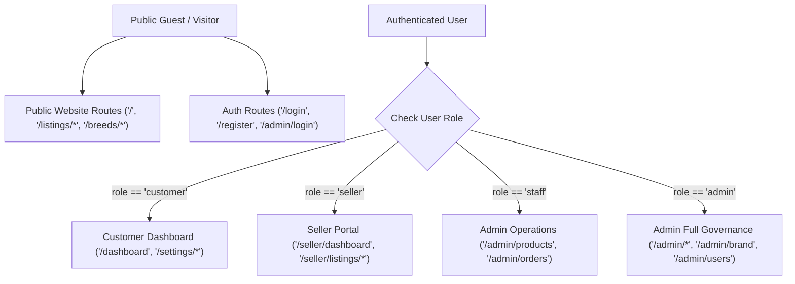

# PawHaven — Route & Component Map

**Document Version:** 1.0  
**Baseline Date:** October 30, 2026  
**Audited Location:** `<project-root>`

---

## 1. Global Route Structure & Middleware Hierarchy

The routing architecture is partitioned into four clear access tiers:
1. **Public Unrestricted:** Accessible to guests and authenticated users.
2. **Authenticated Customer:** Guarded by `['auth', 'verified']`.
3. **Dedicated Seller Portal:** Guarded by `['auth', 'verified', 'seller']`.
4. **Administrative Console:** Guarded by `['auth', 'verified', 'staff_or_admin']` (operational) and `['auth', 'verified', 'admin']` (governance).

---

## 2. Public Website & Catalog Routes

| Verb | Path | Named Route | Controller / Handler | View / Component | Middleware | Related Models | Status |
| :--- | :--- | :--- | :--- | :--- | :--- | :--- | :---: |
| `GET` | `/` | `home` | Closure (`routes/web.php`) | `resources/views/welcome.blade.php` | `web` | `PetListing`, `Product`, `Setting` | **Reuse** |
| `GET` | `/listings` | `listings.index` | `Marketplace\ListingBrowseController@index` | `resources/views/marketplace/index.blade.php` | `web` | `PetListing`, `PetCategory`, `Breed` | **Build new** |
| `GET` | `/listings/{listing:slug}` | `listings.show` | `Marketplace\ListingBrowseController@show` | `resources/views/marketplace/show.blade.php` | `web` | `PetListing`, `ListingImage`, `User` | **Build new** |
| `GET` | `/breeds` | `breeds.index` | `BreedCatalogController@index` | `resources/views/breeds/index.blade.php` | `web` | `Breed`, `PetCategory` | **Build new** |
| `GET` | `/breeds/{breed:slug}` | `breeds.show` | `BreedCatalogController@show` | `resources/views/breeds/show.blade.php` | `web` | `Breed`, `PetListing` | **Build new** |
| `GET` | `/adoption` | `adoption.index` | `AdoptionCommunityController@index` | `resources/views/community/adoption.blade.php` | `web` | `PetListing`, `PetCategory` | **Build new** |
| `GET` | `/cart` | `cart.index` | `Commerce\CartController@index` | `resources/views/shop/cart.blade.php` | `web` | `Product`, Session Cart | **Build new** |
| `POST` | `/cart/add` | `cart.add` | `Commerce\CartController@add` | JSON / Redirect | `web` | `Product`, Session Cart | **Build new** |
| `PATCH` | `/cart/update` | `cart.update` | `Commerce\CartController@update` | JSON / Redirect | `web` | `Product`, Session Cart | **Build new** |
| `DELETE`| `/cart/remove` | `cart.remove` | `Commerce\CartController@remove` | JSON / Redirect | `web` | `Product`, Session Cart | **Build new** |
| `GET` | `/checkout` | `checkout.index` | `Commerce\CheckoutController@index` | `resources/views/shop/checkout.blade.php` | `['web', 'auth', 'verified']` | `Product`, `Order`, `Setting` | **Build new** |
| `POST` | `/checkout` | `checkout.store` | `Commerce\CheckoutController@store` | Redirect to receipt | `['web', 'auth', 'verified']` | `Order`, `OrderItem`, `Product` | **Build new** |
| `GET` | `/checkout/receipt/{order:order_number}` | `checkout.receipt` | `Commerce\CheckoutController@receipt` | `resources/views/shop/receipt.blade.php` | `['web', 'auth', 'verified']` | `Order`, `OrderItem` | **Build new** |

---

## 3. Customer Portal Routes

| Verb | Path | Named Route | Controller / Handler | View / Component | Middleware | Related Models | Status |
| :--- | :--- | :--- | :--- | :--- | :--- | :--- | :---: |
| `GET` | `/dashboard` | `dashboard` | Closure (`routes/web.php`) | `resources/views/dashboard.blade.php` | `['web', 'auth', 'verified']` | `User`, `Order`, `PetListing` | **Repair** |
| `POST` | `/orders/request` | `orders.request` | `OrderRequestController@store` | Redirect to `dashboard` | `['web', 'auth', 'verified']` | `Order`, `OrderItem`, `Product` | **Repair** |
| `GET` | `/settings/profile` | `profile.edit` | Livewire `pages::settings.profile` | `resources/views/pages/settings/⚡profile.blade.php` | `['web', 'auth']` | `User` | **Reuse** |
| `GET` | `/settings/appearance` | `appearance.edit` | Livewire `pages::settings.appearance` | `resources/views/pages/settings/⚡appearance.blade.php` | `['web', 'auth', 'verified']` | `User` | **Reuse** |
| `GET` | `/settings/security` | `security.edit` | Livewire `pages::settings.security` | `resources/views/pages/settings/⚡security.blade.php` | `['web', 'auth', 'verified', 'password.confirm']` | `User` | **Reuse** |

---

## 4. Dedicated Seller Portal Routes (`prefix: seller`)

All seller portal routes are grouped under the `/seller` prefix and protected by `['web', 'auth', 'verified', 'seller']` middleware.

| Verb | Path | Named Route | Controller / Handler | View / Component | Middleware | Related Models | Status |
| :--- | :--- | :--- | :--- | :--- | :--- | :--- | :---: |
| `GET` | `/seller/dashboard` | `seller.dashboard` | `Seller\SellerDashboardController@index` | `resources/views/seller/dashboard.blade.php` | `['auth', 'verified', 'seller']` | `User`, `PetListing` | **Build new** |
| `GET` | `/seller/listings` | `seller.listings.index` | `Seller\SellerListingController@index` | `resources/views/seller/listings/index.blade.php` | `['auth', 'verified', 'seller']` | `PetListing`, `PetCategory` | **Build new** |
| `GET` | `/seller/listings/create` | `seller.listings.create` | `Seller\SellerListingController@create` | `resources/views/seller/listings/create.blade.php` | `['auth', 'verified', 'seller']` | `PetCategory`, `Breed` | **Build new** |
| `POST` | `/seller/listings` | `seller.listings.store` | `Seller\SellerListingController@store` | Redirect to `seller.listings.index` | `['auth', 'verified', 'seller']` | `PetListing`, `ListingImage` | **Build new** |
| `GET` | `/seller/listings/{listing}/edit` | `seller.listings.edit` | `Seller\SellerListingController@edit` | `resources/views/seller/listings/edit.blade.php` | `['auth', 'verified', 'seller']` | `PetListing`, `ListingImage` | **Build new** |
| `PUT` | `/seller/listings/{listing}` | `seller.listings.update` | `Seller\SellerListingController@update` | Redirect to `seller.listings.index` | `['auth', 'verified', 'seller']` | `PetListing`, `ListingImage` | **Build new** |
| `DELETE`| `/seller/listings/{listing}` | `seller.listings.destroy` | `Seller\SellerListingController@destroy` | Redirect to `seller.listings.index` | `['auth', 'verified', 'seller']` | `PetListing` | **Build new** |
| `PATCH`| `/seller/listings/{listing}/status` | `seller.listings.status` | `Seller\SellerListingController@updateStatus` | Redirect to `seller.listings.index` | `['auth', 'verified', 'seller']` | `PetListing` | **Build new** |

---

## 5. Administrative Console Routes (`prefix: admin`)

### Operational Tier: Guarded by `['web', 'auth', 'verified', 'staff_or_admin']`

| Verb | Path | Named Route | Controller / Handler | View / Component | Related Models | Status |
| :--- | :--- | :--- | :--- | :--- | :--- | :---: |
| `GET` | `/admin` | `admin.dashboard` | `Admin\DashboardController@index` | `resources/views/admin/dashboard.blade.php` | `Order`, `Product`, `PetListing` | **Reuse** |
| `GET` | `/admin/products` | `admin.products.index` | `Admin\ProductController@index` | `resources/views/admin/products/index.blade.php` | `Product`, `ProductCategory` | **Reuse** |
| `GET` | `/admin/products/create` | `admin.products.create` | `Admin\ProductController@create` | `resources/views/admin/products/create.blade.php` | `ProductCategory` | **Reuse** |
| `POST` | `/admin/products` | `admin.products.store` | `Admin\ProductController@store` | Redirect to `admin.products.index` | `Product` | **Reuse** |
| `GET` | `/admin/products/{product}/edit` | `admin.products.edit` | `Admin\ProductController@edit` | `resources/views/admin/products/edit.blade.php` | `Product`, `ProductCategory` | **Reuse** |
| `PUT` | `/admin/products/{product}` | `admin.products.update` | `Admin\ProductController@update` | Redirect to `admin.products.index` | `Product` | **Reuse** |
| `DELETE`| `/admin/products/{product}` | `admin.products.destroy` | `Admin\ProductController@destroy` | Redirect to `admin.products.index` | `Product`, `OrderItem` | **Reuse** |
| `GET` | `/admin/categories` | `admin.categories.index` | `Admin\ProductCategoryController@index` | `resources/views/admin/categories/index.blade.php` | `ProductCategory` | **Reuse** |
| `POST` | `/admin/categories` | `admin.categories.store` | `Admin\ProductCategoryController@store` | Redirect to `admin.categories.index` | `ProductCategory` | **Reuse** |
| `PUT` | `/admin/categories/{category}` | `admin.categories.update` | `Admin\ProductCategoryController@update` | Redirect to `admin.categories.index` | `ProductCategory` | **Reuse** |
| `DELETE`| `/admin/categories/{category}` | `admin.categories.destroy` | `Admin\ProductCategoryController@destroy` | Redirect to `admin.categories.index` | `ProductCategory` | **Reuse** |
| `GET` | `/admin/inventory` | `admin.inventory.index` | `Admin\InventoryController@index` | `resources/views/admin/inventory/index.blade.php` | `Product` | **Reuse** |
| `PATCH`| `/admin/inventory/{product}` | `admin.inventory.update` | `Admin\InventoryController@update` | Redirect to `admin.inventory.index` | `Product` | **Reuse** |
| `GET` | `/admin/orders` | `admin.orders.index` | `Admin\OrderController@index` | `resources/views/admin/orders/index.blade.php` | `Order` | **Reuse** |
| `GET` | `/admin/orders/{order}` | `admin.orders.show` | `Admin\OrderController@show` | `resources/views/admin/orders/show.blade.php` | `Order`, `OrderItem` | **Reuse** |
| `PATCH`| `/admin/orders/{order}/status` | `admin.orders.update-status` | `Admin\OrderController@updateStatus` | Redirect to `admin.orders.show` | `Order`, `OrderStatus` | **Reuse** |
| `PATCH`| `/admin/orders/{order}/payment` | `admin.orders.update-payment` | `Admin\OrderController@updatePayment` | Redirect to `admin.orders.show` | `Order`, `PaymentStatus` | **Reuse** |
| `GET` | `/admin/customers` | `admin.customers.index` | `Admin\CustomerController@index` | `resources/views/admin/customers/index.blade.php` | `User`, `Order` | **Reuse** |
| `GET` | `/admin/marketplace/listings` | `admin.marketplace.listings.index` | `Admin\MarketplaceListingController@index` | `resources/views/admin/marketplace/index.blade.php` | `PetListing` | **Reuse** |
| `GET` | `/admin/marketplace/listings/{listing}` | `admin.marketplace.listings.show` | `Admin\MarketplaceListingController@show` | `resources/views/admin/marketplace/show.blade.php` | `PetListing`, `ListingImage` | **Reuse** |
| `GET` | `/admin/breeds` | `admin.breeds.index` | `Admin\BreedController@index` | `resources/views/admin/breeds/index.blade.php` | `Breed`, `PetCategory` | **Reuse** |
| `POST` | `/admin/breeds` | `admin.breeds.store` | `Admin\BreedController@store` | Redirect to `admin.breeds.index` | `Breed` | **Reuse** |
| `DELETE`| `/admin/breeds/{breed}` | `admin.breeds.destroy` | `Admin\BreedController@destroy` | Redirect to `admin.breeds.index` | `Breed` | **Reuse** |
| `GET` | `/admin/community` | `admin.community.index` | `Admin\CommunityController@index` | `resources/views/admin/community/index.blade.php` | `Setting` | **Reuse** |
| `PUT` | `/admin/community` | `admin.community.update` | `Admin\CommunityController@update` | Redirect to `admin.community.index` | `Setting` | **Reuse** |

---

### Governance Tier: Guarded by `['web', 'auth', 'verified', 'admin']`

| Verb | Path | Named Route | Controller / Handler | View / Component | Related Models | Status |
| :--- | :--- | :--- | :--- | :--- | :--- | :---: |
| `GET` | `/admin/brand` | `admin.brand.index` | `Admin\BrandIdentityController@index` | `resources/views/admin/brand/index.blade.php` | `Setting` | **Reuse** |
| `PUT` | `/admin/brand` | `admin.brand.update` | `Admin\BrandIdentityController@update` | Redirect to `admin.brand.index` | `Setting`, `AdminAuditLog` | **Reuse** |
| `GET` | `/admin/homepage` | `admin.homepage.index` | `Admin\HomepageCustomizerController@index` | `resources/views/admin/homepage/index.blade.php` | `Setting` | **Reuse** |
| `PUT` | `/admin/homepage` | `admin.homepage.update` | `Admin\HomepageCustomizerController@update` | Redirect to `admin.homepage.index` | `Setting`, `AdminAuditLog` | **Reuse** |
| `GET` | `/admin/marketplace/moderation` | `admin.marketplace.moderation.index` | `Admin\MarketplaceModerationController@index` | `resources/views/admin/marketplace/moderation.blade.php` | `PetListing` | **Reuse** |
| `POST` | `/admin/marketplace/moderation/{listing}/approve` | `admin.marketplace.moderation.approve` | `Admin\MarketplaceModerationController@approve` | Redirect to `admin.marketplace.moderation.index` | `PetListing`, `ListingModerationAction` | **Reuse** |
| `POST` | `/admin/marketplace/moderation/{listing}/reject` | `admin.marketplace.moderation.reject` | `Admin\MarketplaceModerationController@reject` | Redirect to `admin.marketplace.moderation.index` | `PetListing`, `ListingModerationAction` | **Reuse** |
| `GET` | `/admin/marketplace/categories` | `admin.marketplace.categories.index` | `Admin\MarketplaceCategoryController@index` | `resources/views/admin/marketplace/categories.blade.php` | `PetCategory` | **Reuse** |
| `POST` | `/admin/marketplace/categories` | `admin.marketplace.categories.store` | `Admin\MarketplaceCategoryController@store` | Redirect to `admin.marketplace.categories.index` | `PetCategory` | **Reuse** |
| `DELETE`| `/admin/marketplace/categories/{category}` | `admin.marketplace.categories.destroy` | `Admin\MarketplaceCategoryController@destroy` | Redirect to `admin.marketplace.categories.index` | `PetCategory`, `Breed`, `PetListing` | **Reuse** |
| `GET` | `/admin/users` | `admin.users.index` | `Admin\UserController@index` | `resources/views/admin/users/index.blade.php` | `User` | **Reuse** |
| `PATCH`| `/admin/users/{user}/role` | `admin.users.update-role` | `Admin\UserController@updateRole` | Redirect to `admin.users.index` | `User`, `AdminAuditLog` | **Reuse** |
| `GET` | `/admin/audit-logs` | `admin.audit-logs.index` | `Admin\AuditLogController@index` | `resources/views/admin/audit-logs/index.blade.php` | `AdminAuditLog` | **Reuse** |
| `GET` | `/admin/settings/shop` | `admin.settings.shop` | `Admin\BusinessSettingController@shop` | `resources/views/admin/settings/shop.blade.php` | `Setting` | **Reuse** |
| `PUT` | `/admin/settings/shop` | `admin.settings.shop.update` | `Admin\BusinessSettingController@updateShop` | Redirect to `admin.settings.shop` | `Setting`, `AdminAuditLog` | **Reuse** |
| `GET` | `/admin/settings/features` | `admin.settings.features` | `Admin\BusinessSettingController@features` | `resources/views/admin/settings/features.blade.php` | `Setting` | **Reuse** |
| `PUT` | `/admin/settings/features` | `admin.settings.features.update` | `Admin\BusinessSettingController@updateFeatures` | Redirect to `admin.settings.features` | `Setting`, `AdminAuditLog` | **Reuse** |
| `POST` | `/admin/settings/branches` | `admin.settings.branches.store` | `Admin\BusinessSettingController@storeBranch` | Redirect to `admin.settings.features` | `Branch`, `AdminAuditLog` | **Reuse** |
| `DELETE`| `/admin/settings/branches/{branch}` | `admin.settings.branches.destroy` | `Admin\BusinessSettingController@destroyBranch` | Redirect to `admin.settings.features` | `Branch`, `AdminAuditLog` | **Reuse** |

---

## 6. Layouts & Master Blade Shells

1. **`resources/views/layouts/admin.blade.php`**:
   - Master layout for all administrative operations and governance routes.
   - Includes top navigation bar, collapsible dark-theme sidebar (`resources/views/layouts/admin/nav.blade.php`), flash notifications, and authenticated user profile menu.
2. **`resources/views/layouts/seller.blade.php`** (to be created):
   - Master layout for the seller portal, styled with PawHaven design tokens (Forest Green, Charcoal, Warm Ivory).
   - Sidebar anchors: *Overview Dashboard*, *My Pet Listings*, *Submit New Pet*, *Moderation Notices*, *Store Profile*.
3. **`resources/views/layouts/app.blade.php`**:
   - Standard Livewire/Flux layout for customer profile, security, and dashboard views.
4. **`resources/views/welcome.blade.php`**:
   - Standalone, highly optimized public landing layout with dynamic announcement bar, accessible desktop navigation, mobile drawer, interactive modals, and brand footer.

